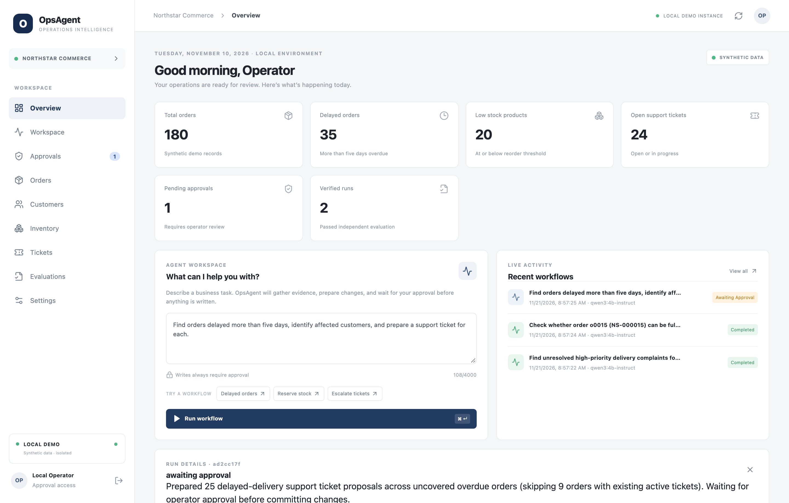
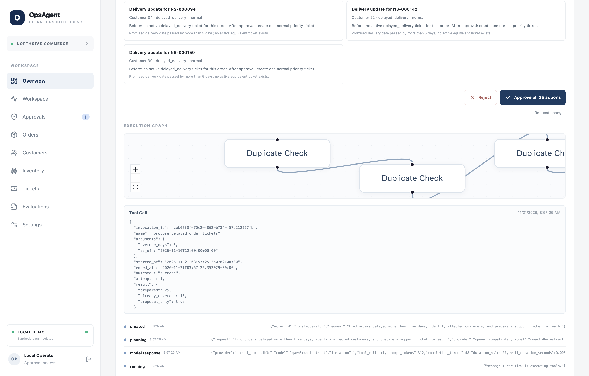
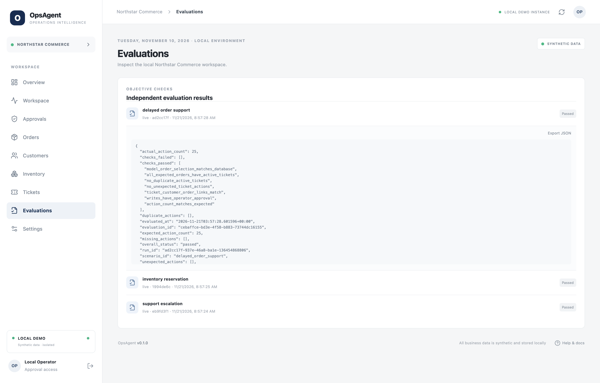
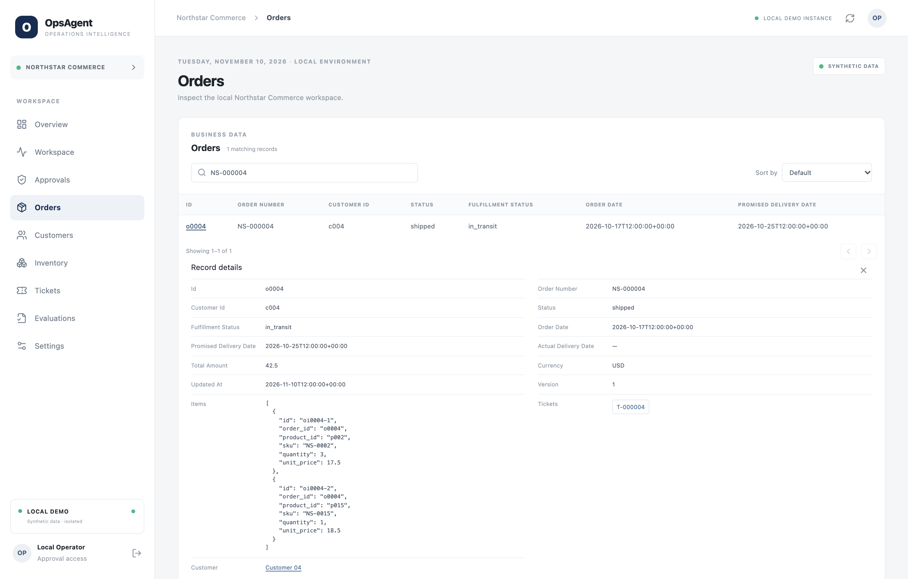
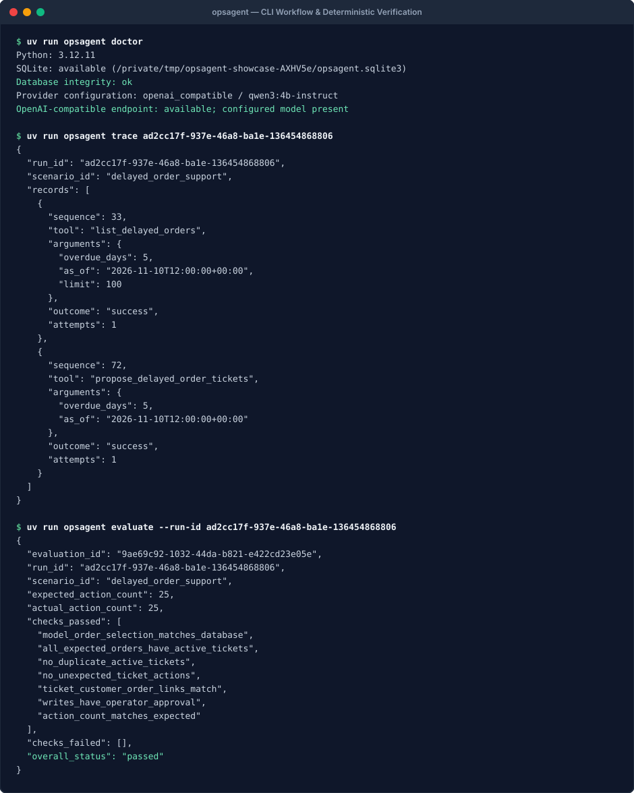
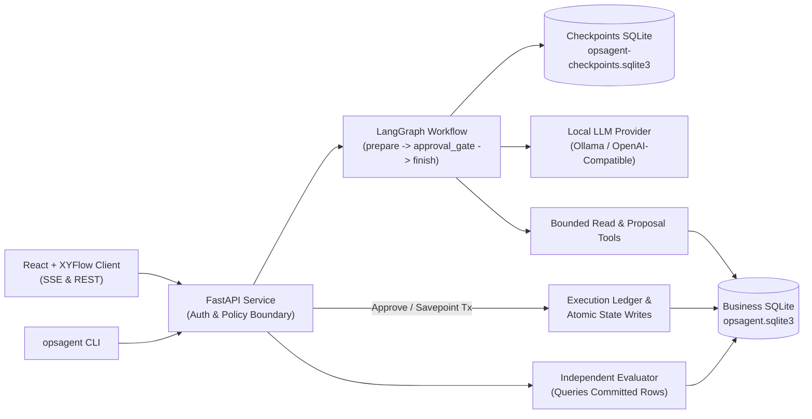

# Business Operations Agent (OpsAgent)

**OpsAgent** is a local-first AI business operations reference system. It gives a configured model provider typed read and proposal tools for a synthetic retail business (**Northstar Commerce**), pauses proposed state changes at a durable LangGraph checkpoint for human approval, executes approved batches atomically in SQLite with an execution ledger, and independently verifies committed database state against scenario invariants.



---

## Why OpsAgent Exists

Most LLM agent demos treat tool-calling prose as proof of work and allow the model to directly mutate application state. In operational environments, untrusted model outputs cannot be allowed to write directly to production databases, create duplicate records on retry, or claim success without independent verification.

OpsAgent demonstrates a bounded, inspectable architecture for human-in-the-loop operational agents:

1. **Strict Read / Proposal Separation**: Model tools can only read bounded business records or stage immutable proposals. No direct model write tool exists.
2. **Cryptographically Bound Human Approval**: Proposals are canonicalized and hashed (`SHA-256`). Approval binds to a stored proposal ID, revision, payload hash, and server-authenticated operator role—clients cannot submit replacement action JSON at approval time.
3. **Transactional Execution & Idempotency Ledger**: On approval, the backend re-verifies business eligibility and optimistic concurrency versions (`version`), writes business mutations and `execution_ledger` entries in a single SQLite `SAVEPOINT` transaction, and rolls back automatically if post-write verification fails.
4. **Independent Outcome Verification**: Evaluators query committed SQLite rows (`support_tickets`, `inventory_reservations`, `inventory`, `execution_ledger`) rather than trusting model summaries.

---

## Key Features

- **Deterministic Northstar Commerce Dataset**: Reproducible synthetic fixture (60 customers, 40 inventory SKUs, 180 orders, 360 order line items, 30 seeded support tickets) evaluated against a fixed reference clock (`2026-11-10T12:00:00+00:00`).
- **Three Bounded Operational Workflows**:
  - **Delayed-Order Support Triage**: Finds open fulfillment orders strictly past the requested overdue threshold, checks existing active tickets to prevent duplicates, and stages missing support tickets.
  - **Inventory Reservation**: Checks order eligibility (`pending` or `processing`) and free stock across all line items, staging atomic stock reservations with optimistic version checks.
  - **Support Ticket Priority Escalation**: Validates open `high`-priority delayed-delivery complaints on currently overdue orders and stages `urgent` priority escalations.
- **Durable LangGraph Checkpointing**: Workflow execution state and approval interrupts (`approval_gate`) are persisted in a dedicated SQLite checkpoint database (`opsagent-checkpoints.sqlite3`) separate from business tables.
- **Local Inference Providers**: Supports native tool calling via **Ollama** (`/api/chat`) and **OpenAI-compatible** local servers (`/v1/chat/completions`, e.g., LM Studio, vLLM, llama.cpp).
- **Interactive React + XYFlow Workspace**: Real-time resumable SSE event streaming (`Last-Event-ID`), interactive execution graph with payload inspection, proposal review (approve, reject, or request replanning changes), objective evaluation JSON export, and cross-linked business data explorer.
- **Role-Based Local Access**: Server-validated credentials distinguish between an **Operator** (`local-operator-token`, authorized to approve, reject, revise, and reset) and a read-only **Auditor** (`local-auditor-token`).
- **ToolFault / ToolTwin Trace Export**: Exports machine-readable tool schemas (`/api/tools`) and sanitized, ordered invocation traces (`/api/runs/{id}/trace` or `opsagent trace <RUN_ID>`).

---

## Visual Walkthrough

### 1. Human-in-the-Loop Proposal Review & Execution Graph

When a workflow stages changes, execution pauses at `awaiting_approval`. Operators inspect every proposed action—including before/after state, target entities, and policy rationale—alongside an interactive XYFlow execution graph and raw tool-call payloads before approving, rejecting, or requesting modifications.



### 2. Independent Database Verification

After an operator approves a proposal, OpsAgent commits the batch and immediately runs a deterministic state evaluator against the committed SQLite tables. If any invariant fails (such as missing coverage, duplicate active tickets, customer/order link mismatch, or unapproved writes), the savepoint is rolled back.



### 3. Business Data Explorer & Cross-Linked Records

Operators and auditors can search, sort, paginate, and drill down into **Orders**, **Customers**, **Inventory**, and **Tickets**, with one-click navigation across linked entities and reservation records.



### 4. Developer CLI & Trace Inspection

The `opsagent` CLI provides full terminal control for health diagnostics (`doctor`), running workflows (`run`, `runs`, `inspect`), exporting sanitized tool traces (`trace`), approving/rejecting proposals (`approve`, `reject`), and running deterministic state verification (`evaluate`).



---

## Architecture Overview



- **LangGraph** manages lifecycle transitions, the `approval_gate` interrupt, and resumable SQLite checkpoints.
- **SQLite** stores synthetic business records and the `execution_ledger` in one transactional database, while graph checkpoints live in a separate database file because workflow state alone cannot prove a committed business mutation.
- **Tool Registry** validates model arguments against strict JSON schemas with bounded retries for malformed calls. Queries are fixed parameterized SQL; the model never generates SQL or executes arbitrary code.

For deeper technical details, see:

- [docs/architecture.md](docs/architecture.md) — System boundaries, persistence separation, and tradeoffs
- [docs/workflows.md](docs/workflows.md) — Lifecycle transitions and strict overdue comparisons
- [docs/approval-model.md](docs/approval-model.md) — Hash verification, transactional savepoints, and replanning
- [docs/tool-contracts.md](docs/tool-contracts.md) — Registered read and proposal tool schemas
- [docs/evaluation.md](docs/evaluation.md) — Deterministic verification invariants
- [docs/development.md](docs/development.md) — Local development and testing workflows
- [docs/limitations.md](docs/limitations.md) — Scope boundaries and reference constraints

---

## Requirements

- **Python** 3.12+ and [`uv`](https://docs.astral.sh/uv/)
- **Node.js** 20+ and `pnpm` (or `npm`)
- **[Ollama](https://ollama.com/)** (default) or an OpenAI-compatible local inference server with a tool-calling model (such as `qwen3:4b-instruct`)

No paid external API or Docker runtime is required.

---

## Quick Start

### 1. Initialize and Start the Backend

From the repository root:

```bash
ollama pull qwen3:4b-instruct
cd backend
uv sync --group dev
uv run opsagent init
uv run opsagent seed
uv run opsagent serve
```

The FastAPI backend starts at `http://127.0.0.1:8000` (interactive OpenAPI docs at `http://127.0.0.1:8000/docs`).

### 2. Start the Frontend Dashboard

In a second terminal:

```bash
cd frontend
pnpm install
pnpm run dev
```

Or start both services in parallel from the repository root using `make dev`.

### 3. Sign In and Run a Workflow

1. Open `http://127.0.0.1:5173`.
2. Sign in with the local demo operator credential:
   - **Operator (read + approval access)**: `local-operator-token`
   - **Auditor (read-only access)**: `local-auditor-token`
3. Submit one of the built-in operational prompts:
   - **Delayed orders**:
     > _"Find orders delayed more than five days, identify affected customers, and prepare a support ticket for each."_
   - **Reserve stock**:
     > _"Check whether order o0015 (NS-000015) can be fulfilled with current inventory and prepare a reservation if possible."_
   - **Escalate tickets**:
     > _"Find unresolved high-priority delivery complaints for delayed orders and prepare escalation of matching tickets to urgent priority."_
4. Inspect the staged actions, execution graph, and tool payloads, then click **Approve** to commit and verify the changes.

---

## Configuration

Copy `.env.example` to `.env` and export desired values in your shell before starting the backend (the service reads environment variables directly and does not auto-load `.env`):

```bash
cp .env.example .env
set -a
source .env
set +a
```

| Variable                             | Default                     | Description                                            |
| :----------------------------------- | :-------------------------- | :----------------------------------------------------- |
| `OPSAGENT_DB`                        | `data/opsagent.sqlite3`     | Path to the SQLite business database                   |
| `OPSAGENT_PROVIDER`                  | `ollama`                    | Inference provider (`ollama` or `openai_compatible`)   |
| `OPSAGENT_MODEL`                     | `qwen3:4b-instruct`         | Tool-calling model identifier                          |
| `OLLAMA_BASE_URL`                    | `http://127.0.0.1:11434`    | Local Ollama server base URL                           |
| `OPENAI_COMPATIBLE_BASE_URL`         | `http://127.0.0.1:1234/v1`  | OpenAI-compatible `/v1` endpoint URL                   |
| `OPSAGENT_AS_OF`                     | `2026-11-10T12:00:00+00:00` | Fixed evaluation timestamp for reproducible results    |
| `OPSAGENT_TEMPERATURE`               | `0.1`                       | Sampling temperature (`0` to `2`)                      |
| `OPSAGENT_NUM_CTX`                   | `8192`                      | Context window size (`512` to `131072`)                |
| `OPSAGENT_MAX_TOKENS`                | `2048`                      | Max completion tokens (`1` to `32768`)                 |
| `OPSAGENT_MODEL_TIMEOUT_SECONDS`     | `60`                        | Per-call model timeout (`1` to `600`)                  |
| `OPSAGENT_EXECUTION_TIMEOUT_SECONDS` | `300`                       | Total run execution timeout (`1` to `1800`)            |
| `OPSAGENT_MAX_ITERATIONS`            | `12`                        | Max planning iterations per run (`1` to `100`)         |
| `OPSAGENT_MAX_TOOL_CALLS`            | `25`                        | Max total tool calls per run (`1` to `500`)            |
| `OPSAGENT_MAX_PROPOSED_ACTIONS`      | `30`                        | Max actions staged in a single proposal (`1` to `500`) |
| `OPSAGENT_MAX_IDENTICAL_TOOL_CALLS`  | `3`                         | Loop guard for identical tool arguments (`1` to `20`)  |
| `OPSAGENT_MAX_RESPONSE_RETRIES`      | `2`                         | Retries for malformed model tool calls (`0` to `10`)   |
| `OPSAGENT_OPERATOR_TOKEN`            | `local-operator-token`      | Demo bearer credential for operator role               |
| `OPSAGENT_AUDITOR_TOKEN`             | `local-auditor-token`       | Demo bearer credential for read-only auditor role      |

Effective runtime settings are exposed on the dashboard **Settings** view (`GET /api/config/public`). Out-of-range values fail fast with a configuration error.

---

## CLI Reference

Run CLI commands from `backend/` using `uv run opsagent`:

```bash
# Check Python, SQLite integrity, and local model server availability
uv run opsagent doctor

# Initialize schema and seed deterministic Northstar Commerce records
uv run opsagent init
uv run opsagent seed

# Start the FastAPI server on 127.0.0.1:8000
uv run opsagent serve

# Trigger a workflow run from the command line
uv run opsagent run "Find orders delayed more than five days, identify affected customers, and prepare a support ticket for each."

# List recent workflow runs or inspect a specific run's events & proposal
uv run opsagent runs
uv run opsagent inspect <RUN_ID>

# Export sanitized ToolFault / ToolTwin invocation trace for a run
uv run opsagent trace <RUN_ID>

# Approve or reject a pending proposal by proposal ID
uv run opsagent approve <PROPOSAL_ID>
uv run opsagent reject <PROPOSAL_ID>

# Run independent deterministic state evaluation on a run
uv run opsagent evaluate --run-id <RUN_ID>

# Reset all synthetic data back to initial seeded state
uv run opsagent reset-demo --confirmed
```

---

## Testing & Verification

Run the test suites from the repository root or per package:

```bash
# Run both backend and frontend unit/integration test suites
make test

# Backend pytest suite (auth, approval transactions, secondary scenarios, replay, LangGraph resume) + Ruff linter
cd backend
uv run pytest
uv run ruff check src tests

# Frontend Vitest component tests + TypeScript & Vite production build
cd frontend
pnpm test
pnpm run build

# End-to-end Playwright browser workflow test (uses a deterministic scripted provider against real FastAPI & SQLite)
cd frontend
pnpm exec playwright install chromium
pnpm run test:e2e
```

---

## Security & Limitations

- All customers, emails (`@example.test`), orders, inventory items, and tickets are synthetic.
- The default bearer tokens (`local-operator-token`, `local-auditor-token`) are public demo values for single-user localhost inspection.
- Keep the service bound to `127.0.0.1`; replacing the demo tokens does not harden the service for network exposure or multi-tenant deployment.
- See [SECURITY.md](SECURITY.md) and [docs/limitations.md](docs/limitations.md) for full details.

## Contributing & License

See [CONTRIBUTING.md](CONTRIBUTING.md) and [CODE_OF_CONDUCT.md](CODE_OF_CONDUCT.md). Licensed under the [MIT License](LICENSE).
